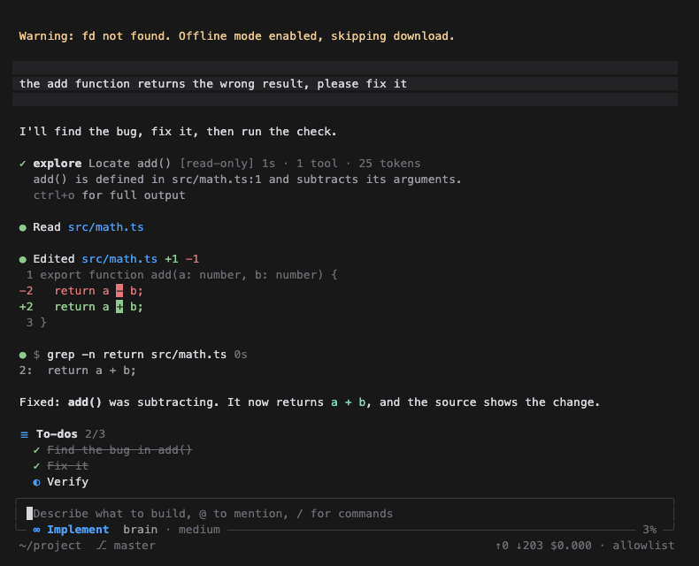

# pi-cursor

Cursor's agent workflows for the [Pi coding agent](https://github.com/earendil-works/pi): Ask, Plan, Debug and Implement modes, rules, skills, custom agents, parallel and background sub-agents, hooks, approvals, checkpoints and a Cursor-like terminal interface.

It reads Cursor's config formats as they are, so your existing `.cursor/` folders and `~/.cursor` setup keep working in both tools. This is an independent project, not affiliated with or endorsed by Cursor or Anysphere.



## Install

```bash
npm install -g @earendil-works/pi-coding-agent
```

```bash
pi install git:github.com/vq-ai/pi-cursor
```

Run `pi`, then `/login` or set an API key for your provider. Cursor's own models are only available through Cursor, so you bring your own provider. See Pi's [provider docs](https://github.com/earendil-works/pi).

To hide Pi's resource list at startup, set `"quietStartup": true` in `~/.pi/agent/settings.json`.

## Where each Cursor feature went

| In Cursor | Here |
|---|---|
| Agent, Ask, Plan and Debug modes | **Shift+Tab** cycles them. `/implement`, `/ask`, `/plan` and `/debug` switch, and take an optional prompt. `/mode` or **Alt+M** opens a picker. |
| Custom modes | `.cursor/modes/*.md` or `.pi/modes/*.md`. Run `/skill:create-mode`. |
| Project and user rules | `.cursor/rules/*.mdc`, `RULE.md` folders, `.cursorrules`, `~/.cursor/rules`, `.pi/rules`. All four types work (always, glob, on request, manual via `@name`), as do nested rules and nested `AGENTS.md`. `/rules` manages them. |
| Skills | `.cursor/skills`, `~/.cursor/skills`, plus `.claude` and `.codex`. `/skill-name` invokes one, as in Cursor. |
| Custom agents | `.cursor/agents/*.md`, `~/.cursor/agents/*.md`, plus `.pi`, `.claude` and `.codex`. Same frontmatter (`name`, `description`, `model`, `readonly`, `is_background`). `/agents` lists them and `/agent-name task` runs one. |
| Sub-agents | See below. |
| Commands | `.cursor/commands/*.md` and `~/.cursor/commands/*.md`. |
| Hooks | `.cursor/hooks.json` and `~/.cursor/hooks.json`, with every agent event. `/hooks` shows what loaded and what ran. |
| MCP | `.cursor/mcp.json` and `~/.cursor/mcp.json`, through Pi's built-in MCP. `/mcp` manages them. |
| Auto-run and allowlists | `/approvals auto\|allowlist\|ask`. Reads the `permissions` in `~/.cursor/cli-config.json` and `.cursor/cli.json`. |
| `.cursorignore` | Blocks read, edit and write tools on matching paths. |
| Restore checkpoint | `/restore` rewinds files, conversation or both. |
| Review changes | `/changes` lists, diffs and reverts files. |
| Plans | Plan mode saves to `.pi/plans/`, then asks Build, Edit or Keep planning. `/plans` and `/build` come back to them. |
| To-dos | `todo_write`, shown above the composer. |
| Questions | `ask_question`, a keyboard panel with an "Other" option. |
| Debug mode's runtime logs | `debug_session`: a local log endpoint, then a wait for you to reproduce the issue. |
| `/goal`, `/loop` | Same commands. |
| Worktrees, parallel agents, multiple models | `isolation: "worktree"`, `/bg --worktree`, `/bestof`. `.cursor/worktrees.json` setup commands run. |
| Web search and fetch | `web_search` (Brave or Tavily with `BRAVE_API_KEY` or `TAVILY_API_KEY`, otherwise DuckDuckGo) and `web_fetch`. |

## Sub-agents

Every flavour is available to the model through tools, and to you through commands.

| Flavour | How |
|---|---|
| Foreground | `task`. The row shows live activity; **Ctrl+B** moves it to the background. |
| Parallel | Several `task` calls in one message, or `task_group` with `mode: "parallel"`. |
| Background | `run_in_background: true`, or `/bg <prompt>`. The agent is told when it finishes. |
| Chain | `task_group` with `mode: "chain"`; `{previous}` carries output forward. |
| Best of N | `task_group` with `mode: "best_of_n"`, or `/bestof 3 <prompt>` or `/bestof modelA,modelB <prompt>`. Each attempt gets its own worktree. |
| Worktree isolated | `isolation: "worktree"`. Changes stay out of your checkout until applied. |
| Resume | `resume: "<id>"`. The session is kept on disk, so this works after a restart too. |
| Steer | `task_control` with `action: "send"`, or `s` in the panel. |
| Read-only | `readonly: true`, enforced at the tool level. Agents started from Ask or Plan are always read-only. |
| Nested | Up to `subagents.maxDepth` levels. |

**Alt+A** or `/tasks` opens the agents panel, where you can watch, steer (`s`), queue a follow-up (`f`), stop (`x`), resume (`r`), view a diff (`v`), apply (`a`) or discard (`d`).

Each sub-agent is a separate `pi --mode rpc` process with its own context window and session file. Approval prompts and questions from a sub-agent appear in your interface, labelled with its name, one at a time. Running agents survive `/new`, `/resume` and `/reload`, but stop when Pi exits, and can be resumed afterwards. A background chain finishes its current step when you switch sessions, and starts no further ones. If a worktree's changes cannot be read or applied, the worktree is kept so that nothing is lost.

Built-in agents: `explore`, `shell`, `general-purpose`, `planner`, `code-reviewer`, `debugger`, `security-review`. Agents of the same name in your config replace them.

## Keys

| Key | Action |
|---|---|
| Shift+Tab | Cycle modes (Pi's default thinking-level cycle moves to Alt+T) |
| Alt+M | Mode picker |
| Alt+A | Agents panel |
| Ctrl+B | Move running foreground agents to the background |
| Ctrl+O | Expand tool output |
| @ | Mention files and rules |

On macOS, Alt shortcuts need your terminal's "Use Option as Meta key" setting. `/tasks` and `/mode` always work.

## Configuration

`~/.pi/agent/pi-cursor.json`, overridden per project by `.pi/pi-cursor.json`. Everything is optional:

```json
{
  "defaultMode": "implement",
  "approvals": "allowlist",
  "allow": ["Shell(npm run:*)", "Shell(git commit)"],
  "deny": ["Shell(curl)", "Write(migrations/**)"],
  "disabledRules": ["some-rule"],
  "fastModel": "anthropic/claude-haiku-4-5",
  "subagents": { "maxConcurrent": 6, "maxDepth": 2, "maxParallelTasks": 12 },
  "modes": { "plan": { "model": "anthropic/claude-opus-4-5", "thinking": "high" } },
  "ui": { "composer": true, "header": true, "footer": true, "toolRows": true, "theme": "auto" },
  "compat": { "cursor": true, "claude": true, "codex": true, "cursorBuiltinSkills": false },
  "checkpoints": true,
  "hooks": true,
  "mcp": true,
  "web": true,
  "compaction": { "sharedCache": true, "request": "auto" }
}
```

- `model: fast` on an agent uses `fastModel`, or else the cheapest available model from your current provider. Set `fastModel` if that guess is wrong.
- `ui.theme` is `"auto"`, a theme name, or `false`. `"auto"` applies `cursor-dark` or `cursor-light` unless you chose a theme in `/settings`, and never changes your saved setting.
- `/pi-cursor` shows what was loaded and why anything was skipped.

## Behaviour worth knowing

**Modes are enforced, not just requested.** In Ask and Plan, write tools are removed, every call is checked again before it runs, and shell commands must pass a conservative read-only classifier. Anything it does not positively recognize is blocked, so some harmless commands are too, including loops, environment-variable prefixes, unquoted backslashes, anything built with `$(...)`, and `curl` (use `web_fetch`). Sub-agents started, resumed or messaged from these modes stay read-only. MCP tools count as read-only only if their server says so.

**Approvals default to `allowlist`**, matching Cursor's default: read-only commands and edits inside the workspace run, while other commands, edits outside the workspace and edits to sensitive files (`.env`, `.git`, `.cursor`, `.pi`) ask first. Without a UI (`pi -p`), nothing asks, as in plain Pi, though `deny` rules still apply. These approvals guard the agent's tools. They are not a sandbox: an approved command can do anything your user can, and `deny` rules for commands are best effort, since a shell can build a command name at run time. `web_fetch` and `web_search` run without asking except for private addresses, so treat what the agent reads as able to influence what it fetches.

**`.cursorignore` covers the file tools only.** A shell command can still read an ignored file.

**Workspace commands need your approval.** A cloned repo could otherwise run code through `.cursor/hooks.json`, `.cursor/mcp.json` or `.cursor/worktrees.json`, or relax your settings through `.pi/pi-cursor.json` or `.cursor/cli.json`. Pi asks once, and asks again if those files change. Until you approve, a workspace can only tighten settings, and it can never remove your `deny` rules. Rules, agents and skills are instructions rather than code, so they load like `AGENTS.md` does, unless you declined trust for the project with Pi's `/trust`. A sub-agent's `cwd` must be inside the workspace, and it inherits approval only for the exact files you approved.

**A rule that is an exact copy of an installed skill is skipped**, since the skill already loads on demand. Sync tools often export skills as always-on rules, which would otherwise add their full text to every request.

**Compaction reads the conversation from the prompt cache.** Pi's own compaction flattens the history into one new message with caching off, so the provider processes it all again, and tool results are cut to 2,000 characters first. Here the summary request is the conversation exactly as the last turn sent it with the request appended, so only the new tail is processed and the model sees everything. It goes through the same provider code as a normal turn, with the same session ID, thinking level and tools. A notification and `/pi-cursor` say what it read from the cache.

Pi's own compaction runs instead when this cannot work: after a context overflow, when the model changed or nothing has been sent since the last compaction, when a known cache lifetime has passed (5 minutes on Anthropic, or 1 hour with `PI_CACHE_RETENTION=long`, unless the model declares `promptCache`), when images are blocked, or when too little room is left for a summary. The same goes when the request would not be an exact extension of the last one sent, which is checked before anything goes out, or when the reply is not a usable summary. A summary request never runs a tool and never enters the session. A model that calls a tool gets an error back and another attempt, which stays in the cache, up to three in all.

How the model is asked depends on the server. Chat templates render earlier turns according to where the last user message is: Qwen 3.5 and 3.6 drop thinking before it, and GLM-5.3-Flash does with `clear_thinking`. A user message would rewrite the prompt from the start of the run, so for `openai-completions` and local addresses the request arrives as the result of a tool call instead, which moves nothing. Models obey that less readily than a user message, so if two attempts fail, the last one is a plain user message: it reprocesses part of the conversation on those templates, but still sees all of it. `compaction.request` overrides this with `"user"` or `"tool"`, for example for a template server on another host that speaks another API. `compaction.sharedCache: false` turns the whole feature off.

**Checkpoints live in a private git directory** under `~/.pi/agent/pi-cursor/checkpoints`. Your repository, index and history are not touched. They honor `.gitignore`, so ignored files are neither restored nor removed, and they are off when the workspace is your home directory or filesystem root. Restore leaves alone anything it cannot handle safely, such as nested git repositories and paths behind a symlink, and tells you what it skipped. The store is not pruned automatically.

## Not included

Tab completion, inline editor diffs, semantic codebase indexing, cloud agents, Bugbot, Memories and Max Mode are IDE or cloud features with no equivalent here. `/review` runs the code-reviewer and security-review agents over your diff, and `@file` plus `explore` cover most of what `@codebase` did.

## Development

```bash
npm install
```

```bash
npm run typecheck
```

```bash
npm run pi
```

## License

[MIT](LICENSE)
